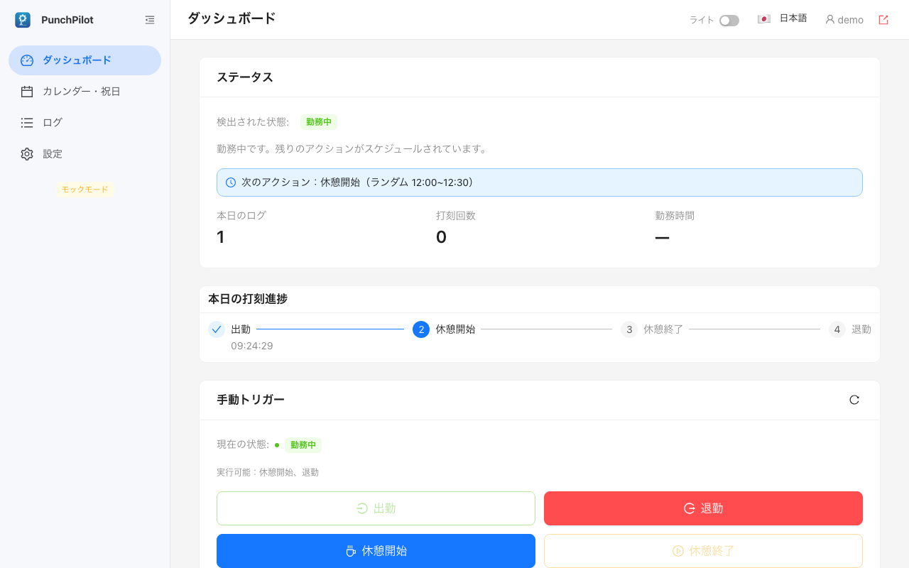
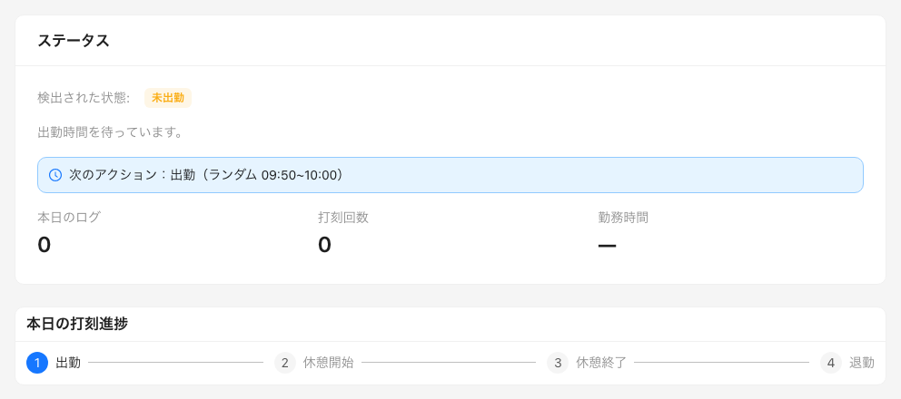
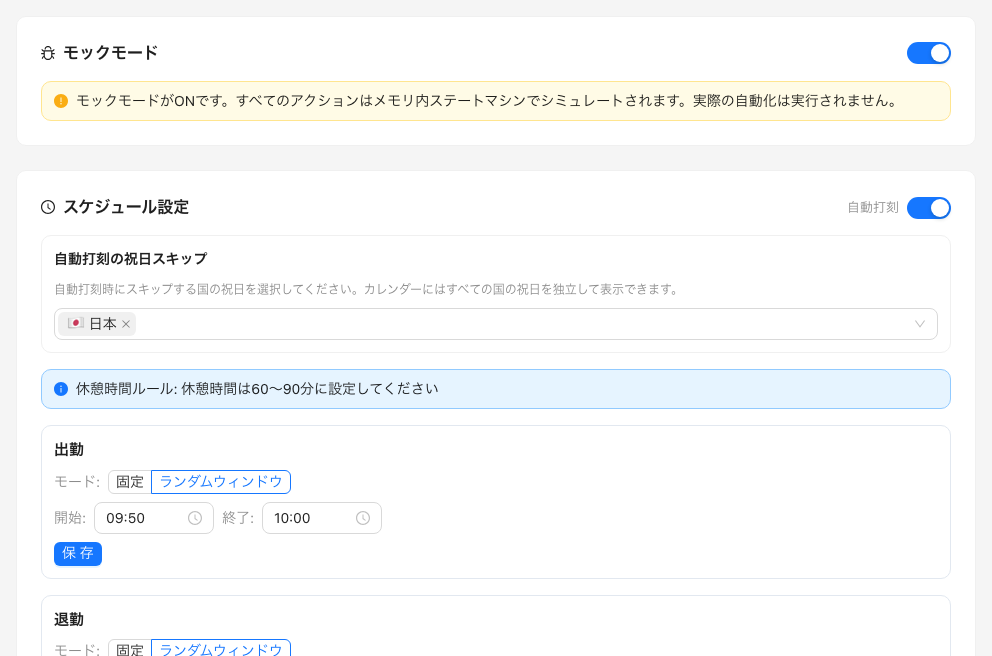

<p align="center">
  
</p>

<h1 align="center">PunchPilot</h1>

<p align="center"><b>出勤・退勤の打刻忘れをなくします。PunchPilot が、お手元のパソコンやサーバーから <a href="https://www.freee.co.jp/hr/">freee人事労務</a>の打刻を代わりに行います。</b></p>

<p align="center"><a href="README.md">English</a> | <a href="README.zh-CN.md">简体中文</a></p>

<p align="center"><a href="#punchpilot-のある一日">PunchPilot のある一日</a> · <a href="#安全ですか">安全ですか？</a> · <a href="#インストール">インストール</a> · <a href="#よくある質問">よくある質問</a></p>

<p align="center">
  
  <br>
  <sub>サンプルデータを使ったモックモードのデモです。freee には何も送信されていません。</sub>
</p>

> [!WARNING]
> PunchPilot はあなたの勤怠記録に書き込みます。自動打刻が認められているかどうかは会社のルール次第ですので、利用前に必ず確認してください。
> 非公式のツールで、freee株式会社とは提携関係がありません。ご自身の責任でご利用ください。

*個人用 · セルフホスト · MIT · 最初に一度だけ、Docker に慣れた方によるインストールが必要です。*

## PunchPilot のある一日

freee人事労務で勤怠を記録している会社では、勤務日は毎日、出勤・休憩開始・休憩終了・退勤を打刻する必要があります。一度でも忘れると、あとで修正申請をしなければなりません。PunchPilot が、その打刻を代わりに行います。

### 一日の予定を立てます

<p align="center">
  
  <br>
  <sub><b>設定した時刻に 4 回打刻します。</b>それぞれ固定時刻にするか、時間帯の中からランダムな 1 分を選べます。デモデータです。</sub>
</p>

毎日深夜 0 時を過ぎると、その日の出勤・休憩開始・休憩終了・退勤の時刻を決めます。初期値は、出勤 09:50–10:00、休憩開始 12:00–12:30、休憩終了 13:00–13:30、退勤 19:00–20:00 です。

### 打刻はしても、主導権はあなたにあります

冒頭のスクリーンショットのとおり、**打刻の直前に、もう一度 freee の状態を確認します。** すでに手動で打刻していれば何もしません。状態を確認できないときは一時停止し、その旨をダッシュボードに表示します。

freee にすでにある打刻を上書きすることはありません。

### 休みの日はスキップします

<p align="center">
  
  <br>
  <sub><b>土日、日本の祝日、自分で追加したカスタム祝日は自動でスキップします。</b></sub>
</p>

freee 上で全日休暇になっている日もスキップします。中国の祝日をスキップするかどうかは任意で選べます。

出勤時刻に PunchPilot が動いていなかった場合は、5 分以内の遅れならすぐに出勤を打刻します。それ以上遅れたときは、freee でご自身で打刻してください。再試行などの細かい動作は [docs/how-it-works.md](docs/how-it-works.md) をご覧ください。

freee アカウントを接続すると、同じ Web 画面から、打刻漏れの補正、休暇申請や勤務に関する申請、月次締め、申請の承認もできます。詳しくは [docs/daily-use.md](docs/daily-use.md) をご覧ください。実際の freee アカウントが必要なため、ここでは画面を掲載していません。

## ほかにできること

- **打刻漏れを直す。** **打刻補正** を押して、**漏れを全選択** を選びます。
- **休暇・残業・休日出勤を申請する。**
- **承認前の申請を取り下げる。**
- **部下の申請を承認する。** freee で承認者になっている場合です。
- **月を締める。**
- **今すぐ打刻する。** ダッシュボードの **手動トリガー** から行います。

モックモードでは、今すぐ打刻するは freee なしで使えます。本番の打刻とほかの項目には、インストールの手順 5 で設定する freee への接続が必要です（freee API、または一部の項目は freee Webログイン）。どの項目がどちらを使うかは、[docs/daily-use.md](docs/daily-use.md) の「やりたいこと別」の操作ガイドにあります。

## 安全ですか？

- **お手元のマシンで動きます。** サーバーが接続するのは freee と公開の祝日カレンダーだけで、テレメトリはありません。
- **認証情報は暗号化して保存します。** 保存先はご自身のサーバー上です。
- **お預けいただくもの：** OAuth で連携する freee の開発者アプリ（Client ID と Client Secret）。任意で、必要な機能のために freee の Web ログイン情報（メールアドレス、パスワード、正確な事業所名）も使えます。
- **推測で動かず、一時停止してログに記録します。** たとえば、勤怠の状態や休暇、操作対象の freee アカウントを確認できないときです。
- **メールやチャットでの通知はしません。** ダッシュボードとログを確認してください。

**まずは安全に試せます：** 新しくインストールした直後はモックモードで、打刻を模擬するだけです。モックモードをオフにするまで、打刻は freee に届きません。ただし freee に接続したあとは、打刻修正や各種申請はモックモード中でも実際に freee へ送信されます。

詳しくは [SECURITY.md](SECURITY.md) と [docs/security-threat-model.md](docs/security-threat-model.md) をご覧ください。

## インストール

**必要なもの：**

- 勤務時間中に電源が入っていて、スリープしないパソコン、NAS、サーバー。Docker と Docker Compose が動作し、`linux/amd64` または 64 ビットの `linux/arm64` であること。スリープするノートパソコンでは打刻が漏れます。
- freee人事労務の従業員アカウント。
- freee の開発者アプリ（Client ID と Client Secret）。設定手順は [docs/freee-app-setup.md](docs/freee-app-setup.md) をご覧ください。
- Docker に慣れていない場合は、手順 1 と 2 を同僚に頼んでください。

### 1. 取得して起動します

```bash
git clone https://github.com/sky-zhang01/punchpilot.git
cd punchpilot
cp .env.example .env
docker compose up -d
```

初期値は一般的なパソコン向けです。NAS では `PUID`/`PGID` に別の値が必要な場合があります。詳しくは [docs/configuration.md](docs/configuration.md) をご覧ください。

`punchpilot` コンテナが動いていれば成功です。

### 2. 一回限りの管理者パスワードを表示します

```bash
docker compose exec punchpilot cat /app/keystore/initial-admin-password
```

ターミナルにパスワードが表示されます。

### 3. PunchPilot を開いてログインします

同じマシンで <http://localhost:8681> を開き、`admin` とそのパスワードでログインします。そのあと、ご自身のユーザー名とパスワードを設定します。

<p align="center">
  
  <br>
  <sub>ログイン画面の右上にある言語メニューで日本語や中文に切り替えられます。</sub>
</p>

> [!NOTE]
> NAS やサーバーにはローカルのブラウザがありません。先に HTTPS を設定してください。[リモートアクセス](#リモートアクセス) をご覧ください。

ダッシュボードが表示されます。

### 4. モックモードで試します

ダッシュボードの **手動トリガー** で打刻し、手順にチェックが付いていくのを確認します。サイドバーに **モックモード** のタグが表示されているはずです。

### 5. freee に接続します

まず、freee のアプリに次のコールバック URL が登録されていることを確認します：`http://localhost:8681/api/config/oauth-callback`。`PORT` を変更した場合はそのポート番号に置き換えます。独自の HTTPS アドレスで使う場合は `https://<あなたのアドレス>/api/config/oauth-callback` を登録します。

そのうえで、**設定 → API設定（OAuth2）** に Client ID と Client Secret を入力し、**アプリ認証情報を保存** をクリックします。続けて **freeeで認可** をクリックし、事業所が複数ある場合は使う事業所を選びます。

次に **設定 → スケジュール設定** で、打刻時刻と祝日の扱いを設定します。

<p align="center">
  
  <br>
  <sub>時刻は一度設定すれば十分です。モックモードはオフにするまでオンのままです。</sub>
</p>

任意：**設定 → freee Webログイン** に freee のメールアドレス、パスワード、正確な事業所名を入力します。保存すると自動で確認されます。

設定画面で、事業所が接続済みと表示されます。

### 6. 本番に切り替えます

設定で **モックモード** をオフにします。最初の本番の出勤時刻を過ぎたら、freee に打刻が記録されているか確認してください。

サイドバーの **モックモード** のタグが消え、ダッシュボードに次の打刻予定が表示されます。

## リモートアクセス

初期設定では、ログインできるのは `localhost` の画面からだけです。別の端末から使うには、PunchPilot を HTTPS で公開し、`PUNCHPILOT_PUBLIC_ORIGIN` を設定します。`TRUST_PROXY` には、リバースプロキシのアドレスだけを指定してください。インターネットに直接公開してはいけません。詳しい説明は [docs/remote-access.md](docs/remote-access.md) をご覧ください。

## 動かし続けるために

- **更新：** `punchpilot` フォルダで `git pull` を実行してから、`docker compose up -d` を実行します。事前に [CHANGELOG](CHANGELOG.md) を確認してください。
- **バックアップ：** `./data` フォルダ、`punchpilot_keystore` ボリューム、`.env` をまとめて保存してください。対応する keystore がないと、保存した freee の認証情報は復号できません。
- **設定**（`TZ`、`PORT`、`PUID`/`PGID`、`PUNCHPILOT_IMAGE`）：[docs/configuration.md](docs/configuration.md) をご覧ください。

## よくある質問

<details>
<summary><b>freee につながずに試せますか？</b></summary>

はい。モックモードをオンのままにすれば、打刻は模擬だけになります。インストールの「モックモードで試します」をご覧ください。
</details>

<details>
<summary><b>PunchPilot のパスワードを忘れました。</b></summary>

パスワードを再発行する機能はありません。ログインに 3 回失敗すると、ログイン画面に初期化コマンドが表示されます。このコマンドは PunchPilot のデータと設定をすべて消去しますが、freee 上の記録には影響しません。実行したあと、`docker compose restart punchpilot` で起動し直し（初期パスワードを `.env` で指定している場合は `docker compose up -d --force-recreate punchpilot`）、インストールの手順 2 からやり直してください。
</details>

<details>
<summary><b>ノートパソコンがスリープしても打刻されますか？</b></summary>

されません。勤務時間中に電源が入っていて、スリープしないマシンが必要です。
</details>

<details>
<summary><b>今日は何も起きなかったのはなぜですか？</b></summary>

ダッシュボードの案内表示と **ログ** ページを確認してください。土日、祝日、休暇は意図的にスキップしています。
</details>

<details>
<summary><b>アプリの表示言語は何ですか？</b></summary>

英語、日本語、中国語に対応しています。ログイン画面で切り替えられます。
</details>

<details>
<summary><b>不具合はどこに報告すればよいですか？</b></summary>

[issue](https://github.com/sky-zhang01/punchpilot/issues) を作成してください。バージョン、期待した動作、該当するログの行を書いてください。認証情報は含めないでください。
</details>

## ドキュメント・開発・謝辞・ライセンス

- [ドキュメント](docs/) · [SECURITY.md](SECURITY.md) · [CHANGELOG.md](CHANGELOG.md) · [CONTRIBUTING.md](CONTRIBUTING.md)
- PunchPilot は [@newbdez33](https://github.com/newbdez33) さんの [freee-checkin](https://github.com/newbdez33/freee-checkin) をもとに始まりました。
- [MIT](LICENSE)

非公式のツールで、freee株式会社とは提携関係がありません。freee は各権利者の商標です。
