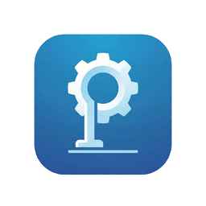
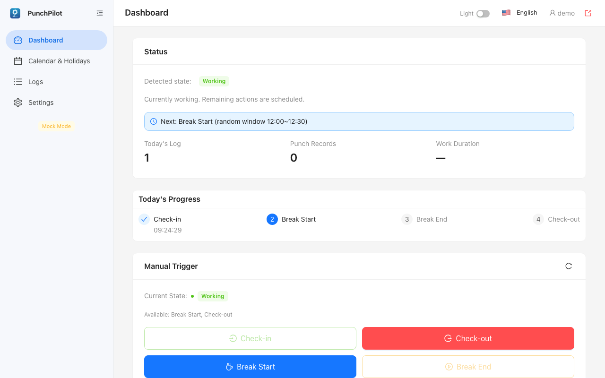
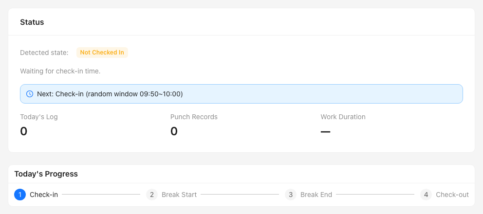
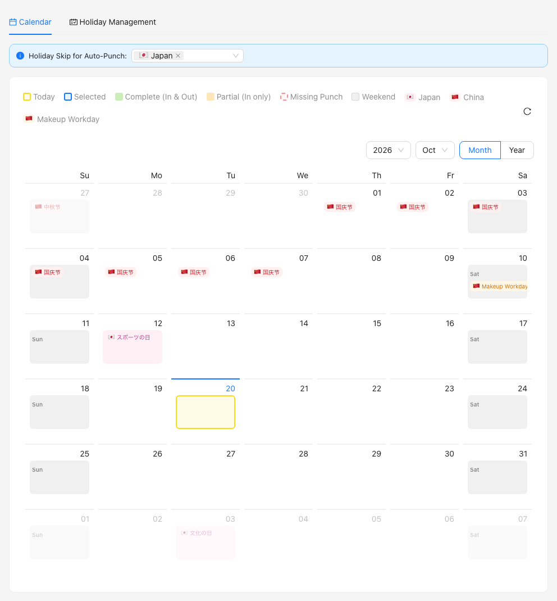
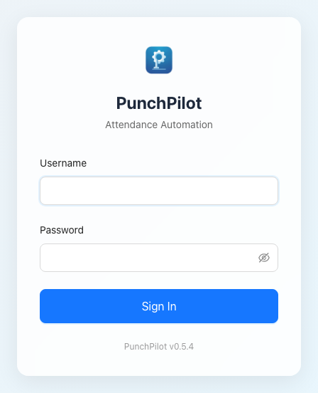
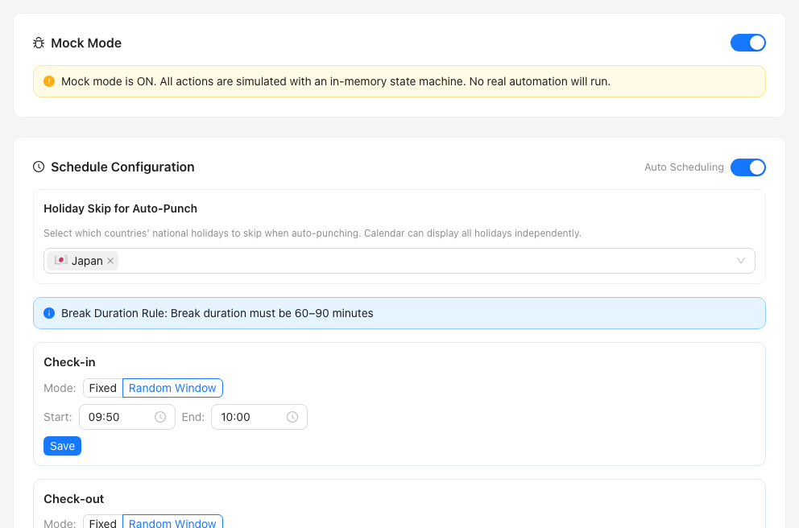

<p align="center">
  
</p>

<h1 align="center">PunchPilot</h1>

<p align="center"><b>Never forget to clock in or out again. PunchPilot punches in <a href="https://www.freee.co.jp/hr/">freee HR</a> (freee人事労務) for you, on your own computer or server.</b></p>

<p align="center"><a href="README.zh-CN.md">简体中文</a> | <a href="README.ja.md">日本語</a></p>

<p align="center"><a href="#a-day-with-punchpilot">A day with PunchPilot</a> · <a href="#is-it-safe">Is it safe?</a> · <a href="#install">Install</a> · <a href="#faq">FAQ</a></p>

<p align="center">
  
  <br>
  <sub>Demo run in Mock Mode with sample data. Nothing was sent to freee.</sub>
</p>

> [!WARNING]
> PunchPilot writes to your attendance record. Whether automatic punching is allowed is your company's rule, so check it before use.
> Unofficial tool, not affiliated with freee K.K.; use at your own risk.

*Single user · self-hosted · MIT · needs someone comfortable with Docker to install it once.*

## A day with PunchPilot

If your company records attendance in freee HR, you must clock in, start and end a break, and clock out every working day. Miss one and you have to file a correction later. PunchPilot does the punching for you.

### It plans your day

<p align="center">
  
  <br>
  <sub><b>Four punches at the times you set.</b> Each is a fixed time or a random minute inside a window. Demo data.</sub>
</p>

Shortly after midnight it plans check-in, break start, break end and check-out. The defaults are check-in 09:50–10:00, break start 12:00–12:30, break end 13:00–13:30 and check-out 19:00–20:00.

### It punches, and you stay in control

As in the screenshot at the top: **before each punch it re-checks freee.** Already punched by hand? It does nothing. Cannot confirm your status? It pauses and says so on the dashboard.

It never overwrites punches that are already in freee.

### It skips days off

<p align="center">
  
  <br>
  <sub><b>Weekends, Japanese public holidays and your own custom holidays are skipped automatically.</b></sub>
</p>

Days that freee shows as full-day leave are skipped too. China public holidays are optional.

If PunchPilot was off at check-in time, it still checks in when it is up to five minutes late; otherwise punch in freee yourself. Retry and edge-case rules are in [docs/how-it-works.md](docs/how-it-works.md).

With a connected freee account, the same web page can also fix missed days, file leave and work requests, close the month and approve requests. These are described in [docs/daily-use.md](docs/daily-use.md) and are not shown here because they need a real freee account.

## What else it can do

- **Fix missed days.** Punch Correction, then Select All Missing.
- **Request leave, overtime or holiday work.**
- **Withdraw a pending request.**
- **Approve your team's requests**, if you are an approver in freee.
- **Close the month.**
- **Punch now.** Manual Trigger on the Dashboard.

In Mock Mode, Punch now works without freee. Real punches and everything else here need a freee connection from Install step 5: the API connection, or for some items the freee Web login. The full "You want to... do this" guide in [docs/daily-use.md](docs/daily-use.md) says which item uses which.

## Is it safe?

- **It runs on your own machine.** The server talks only to freee and to public holiday calendars. There is no telemetry.
- **Credentials are stored encrypted** on your own server.
- **What you hand over:** a freee developer app (Client ID and Secret) through OAuth, and optionally your freee Web login (email, password and the exact company name) for features that need it.
- **It pauses and logs instead of guessing**, for example when it cannot confirm your attendance status, your leave or which freee account it acts for.
- **It sends no email or chat notifications.** Check the dashboard and Logs.

**Safe to try first:** a fresh install starts in Mock Mode, which only simulates punches. No punch reaches freee until you turn it off. Once freee is connected, corrections and requests you file are sent to freee for real, even in Mock Mode.

Details: [SECURITY.md](SECURITY.md) and [docs/security-threat-model.md](docs/security-threat-model.md).

## Install

**You need:**

- A computer, NAS or server that stays on and awake during working hours and runs Docker with Compose (`linux/amd64` or 64-bit `linux/arm64`). A laptop that sleeps misses punches.
- A freee HR employee account.
- A freee developer app (Client ID and Client Secret). Setup guide: [docs/freee-app-setup.md](docs/freee-app-setup.md).
- If Docker is new to you, ask a colleague to do steps 1 and 2.

### 1. Get it and start it

```bash
git clone https://github.com/sky-zhang01/punchpilot.git
cd punchpilot
cp .env.example .env
docker compose up -d
```

The defaults suit a PC. A NAS may need other `PUID`/`PGID` values, see [docs/configuration.md](docs/configuration.md).

You should see the `punchpilot` container running.

### 2. Read the one-time admin password

```bash
docker compose exec punchpilot cat /app/keystore/initial-admin-password
```

You should see a password printed in the terminal.

### 3. Open PunchPilot and sign in

Open <http://localhost:8681> on that machine and sign in as `admin` with that password. Then choose your own username and password.

<p align="center">
  
  <br>
  <sub>The language menu at the top right of the sign-in page switches to 日本語 or 中文.</sub>
</p>

> [!NOTE]
> A NAS or server has no local browser. Set up HTTPS first, see [Remote access](#remote-access-nas-or-server).

You should see the Dashboard.

### 4. Try it in Mock Mode

On the Dashboard, use **Manual Trigger** to punch and watch the steps tick. You should see the **Mock Mode** tag in the sidebar.

### 5. Connect freee

First make sure this callback URL is registered in your freee app: `http://localhost:8681/api/config/oauth-callback`. If you change `PORT`, use that port; for your own HTTPS address use `https://<your address>/api/config/oauth-callback`.

Then, in **Settings → API Configuration (OAuth2)**, paste your Client ID and Client Secret and click **Save App Credentials**. Click **Authorize with freee**, and choose your company if you have more than one.

Next, in **Settings → Schedule Configuration**, set your times and holiday options.

<p align="center">
  
  <br>
  <sub>Set your times once. Mock Mode is on until you turn it off.</sub>
</p>

Optional: in **Settings → freee Web Login**, enter your freee email, password and the exact company name. PunchPilot checks them when you save.

You should see your company connected in Settings.

### 6. Go live

Turn **Mock Mode** off in Settings. After your first real check-in time, confirm in freee that the punch arrived.

You should see the **Mock Mode** tag gone from the sidebar and the next planned punch on the Dashboard.

## Remote access (NAS or server)

By default, sign-in works only from `localhost` pages. To use PunchPilot from another computer, serve it over HTTPS and set `PUNCHPILOT_PUBLIC_ORIGIN`. Set `TRUST_PROXY` only to your reverse proxy's address. Never expose it to the public internet. Full explanation: [docs/remote-access.md](docs/remote-access.md).

## Keep it running

- **Update:** in the `punchpilot` folder run `git pull`, then `docker compose up -d`. Read the [CHANGELOG](CHANGELOG.md) first.
- **Back up** `./data`, the `punchpilot_keystore` volume and `.env` together. Without the matching keystore, saved freee credentials cannot be decrypted.
- **Settings** (`TZ`, `PORT`, `PUID`/`PGID`, `PUNCHPILOT_IMAGE`): [docs/configuration.md](docs/configuration.md).

## FAQ

<details>
<summary><b>Can I try it without connecting to freee?</b></summary>

Yes. Keep Mock Mode on; punches are only simulated. See Install, "Try it in Mock Mode".
</details>

<details>
<summary><b>I forgot my PunchPilot password.</b></summary>

There is no password recovery. After three failed sign-ins, the sign-in page shows a factory-reset command. It erases all PunchPilot data and settings; your freee records are not affected. After running it, restart with `docker compose restart punchpilot` (if your initial password comes from `.env`, use `docker compose up -d --force-recreate punchpilot` instead) and set up again from Install step 2.
</details>

<details>
<summary><b>Will it punch if my laptop sleeps?</b></summary>

No. It needs a machine that stays on and awake during working hours.
</details>

<details>
<summary><b>Why did nothing happen today?</b></summary>

Check the dashboard banner and the Logs page. Weekends, holidays and leave are skipped on purpose.
</details>

<details>
<summary><b>Which language is the app in?</b></summary>

English, Japanese and Chinese. Switch on the sign-in page.
</details>

<details>
<summary><b>Where do I report a problem?</b></summary>

Open an [issue](https://github.com/sky-zhang01/punchpilot/issues). Include your version, what you expected, and the log line, without any credentials.
</details>

## Docs, contributing, acknowledgments, license

- [Docs](docs/) · [SECURITY.md](SECURITY.md) · [CHANGELOG.md](CHANGELOG.md) · [CONTRIBUTING.md](CONTRIBUTING.md)
- PunchPilot started from [freee-checkin](https://github.com/newbdez33/freee-checkin) by [@newbdez33](https://github.com/newbdez33).
- [MIT](LICENSE).

Unofficial; not affiliated with freee K.K.; freee is a trademark of its owner.
