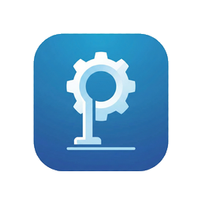
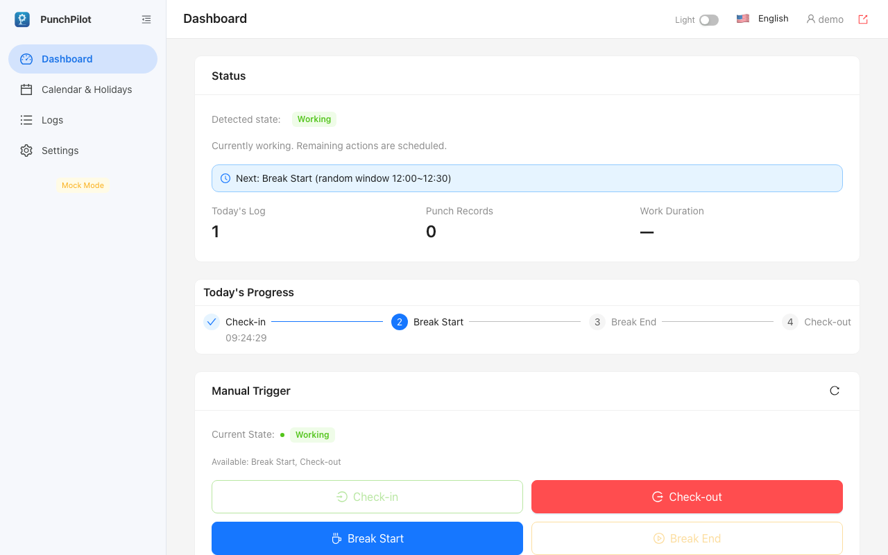
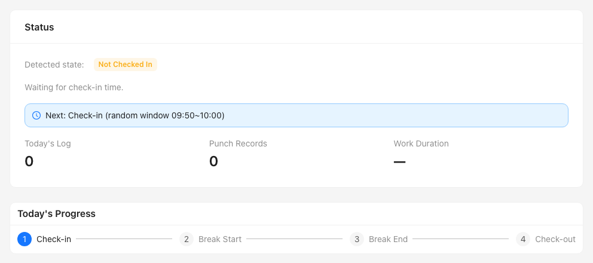
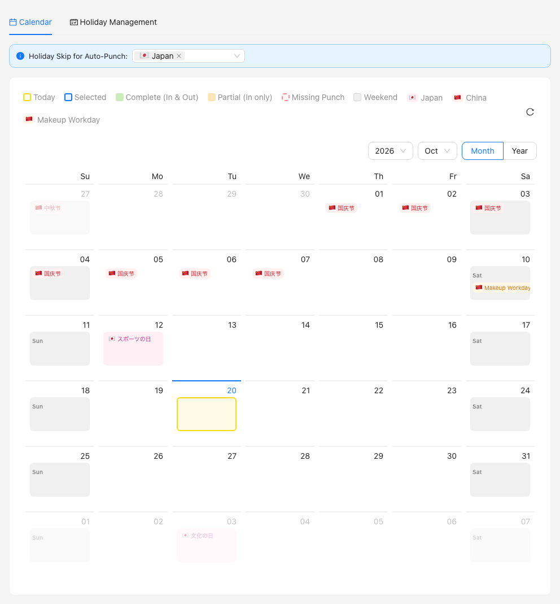
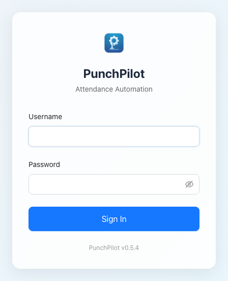
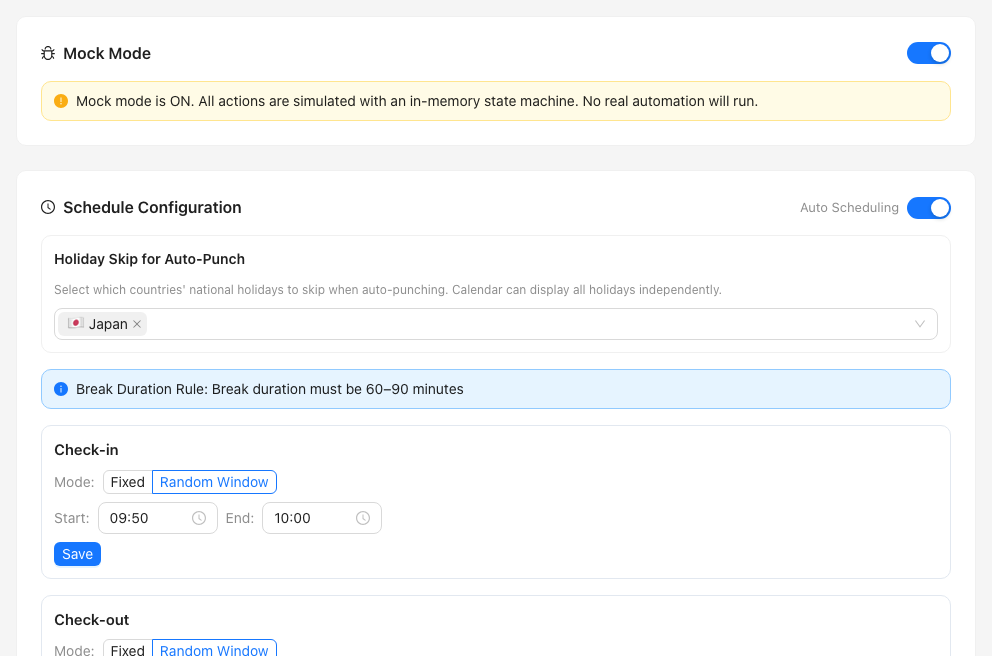

<p align="center">
  
</p>

<h1 align="center">PunchPilot</h1>

<p align="center"><b>Never forget to clock in or out again. PunchPilot punches in <a href="https://www.freee.co.jp/hr/">freee HR</a> (freee人事労務) for you, on your own computer or server.</b></p>

<p align="center"><a href="README.zh-CN.md">简体中文</a> | <a href="README.ja.md">日本語</a></p>

<p align="center"><a href="#a-day-with-punchpilot">A day with PunchPilot</a> · <a href="#is-it-safe">Is it safe?</a> · <a href="#install">Install</a> · <a href="#faq">FAQ</a></p>

<p align="center">
  
  <br>
  <sub>Demo run in Mock Mode with sample data. Nothing was sent to freee.</sub>
</p>

> [!WARNING]
> PunchPilot writes to your attendance record. Whether automatic punching is allowed is your company's rule, so check it before use.
> Unofficial tool, not affiliated with freee K.K.; use at your own risk.

*Single user · self-hosted · MIT · needs someone comfortable with Docker to install it once.*

## A day with PunchPilot

If your company records attendance in freee HR, you must clock in, start and end a break, and clock out every working day. Miss one and you have to file a correction later. PunchPilot does the punching for you.

### It plans your day

<p align="center">
  
  <br>
  <sub><b>Four punches at the times you set.</b> Each is a fixed time or a random minute inside a window. Demo data.</sub>
</p>

Shortly after midnight it plans check-in, break start, break end and check-out. The defaults are check-in 09:50–10:00, break start 12:00–12:30, break end 13:00–13:30 and check-out 19:00–20:00. Automatic punches also keep at least 8 hours of net work (check-out minus check-in minus break) by default, and plan breaks of 60 to 75 minutes. Both limits are editable in **Settings → Schedule Configuration**.

### It punches, and you stay in control

As in the screenshot at the top: **before each punch it re-checks freee.** Already punched by hand? It does nothing. Cannot confirm your status? It pauses and says so on the dashboard.

It never overwrites punches that are already in freee.

### It skips days off

<p align="center">
  
  <br>
  <sub><b>Weekends, Japanese public holidays and your own custom holidays are skipped automatically.</b></sub>
</p>

Days that freee shows as full-day leave are skipped too. China public holidays are optional.

If PunchPilot was off at check-in time, it still checks in when it is up to five minutes late; otherwise punch in freee yourself. If PunchPilot is running but freee is temporarily unavailable or rate-limited, it retries for about an hour. Before each retry it reads freee's punch history, so nothing is punched twice. The dashboard may show the step as failed while retries run. If the punch still fails, the **Logs** page records the reason and you punch in freee yourself.

With a connected freee account, the same web page can also fix missed days, file leave, overtime and holiday work requests, withdraw pending requests, approve your team's requests and close the month. These are not shown here because they need a real freee account.

## What else it can do

- **Fix missed days.** Punch Correction, then Select All Missing.
- **Request leave, overtime or holiday work.**
- **Withdraw a pending request.**
- **Approve your team's requests**, if you are an approver in freee.
- **Close the month.**
- **Punch now.** Manual Trigger on the Dashboard.

In Mock Mode, Punch now works without freee. Real punches and everything else here need the freee connection from Install step 5. Most items use the API connection; a few need the freee Web login too:

| Item | What it needs |
| --- | --- |
| Scheduled and manual punches | API connection |
| Punch Correction, leave and overtime requests, withdrawing a request | API connection |
| Holiday work requests | freee Web login, always |
| Incoming Requests and approvals | API connection; shown when your company uses freee approval routes |
| Monthly Closing | Shown when your company uses approval routes or a freee Web login is saved |

If you skip the Web login, everything the API can do still works. PunchPilot also uses the Web login when your company's approval routes cannot be handled through the API.

## Is it safe?

- **It runs on your own machine.** The server talks only to freee and to public holiday calendars. There is no telemetry.
- **Credentials are stored encrypted** on your own server.
- **What you hand over:** a freee developer app (Client ID and Secret) through OAuth, and optionally your freee Web login (email, password and the exact company name) for features that need it.
- **It pauses and logs instead of guessing**, for example when it cannot confirm your attendance status, your leave or which freee account it acts for.
- **It sends no email or chat notifications.** Check the dashboard and Logs.

**Safe to try first:** a fresh install starts in Mock Mode, which only simulates punches. No punch reaches freee until you turn it off. Once freee is connected, corrections and requests you file are sent to freee for real, even in Mock Mode.

To report a security vulnerability, use GitHub's [private vulnerability reporting](https://github.com/sky-zhang01/punchpilot/security/advisories/new). Please do not open a public issue for it.

## Install

**You need:**

- A computer, NAS or server that stays on and awake during working hours and runs Docker with Compose (`linux/amd64` or 64-bit `linux/arm64`). A laptop that sleeps misses punches.
- A freee HR employee account.
- A freee developer app (Client ID and Client Secret). See the next section.
- If Docker is new to you, ask a colleague to do steps 1 and 2.

### Register a freee developer app

Create the app in the freee developers console by following the official guide at <https://developer.freee.co.jp/>. Its menus change, so they are not repeated here. The one value PunchPilot dictates is the callback URL, which you register in the app:

| How you reach PunchPilot | Callback URL to register |
| --- | --- |
| On the same computer | `http://localhost:8681/api/config/oauth-callback` |
| Same computer, changed `PORT` | `http://localhost:<your port>/api/config/oauth-callback` |
| Your own HTTPS address (see [Remote access](#remote-access-nas-or-server)) | `https://<your address>/api/config/oauth-callback` |

If you later move to another address or port, register the matching callback URL as well.

### 1. Get it and start it

```bash
git clone https://github.com/sky-zhang01/punchpilot.git
cd punchpilot
cp .env.example .env
docker compose up -d
```

The defaults suit a PC. A NAS may need other `PUID`/`PGID` values, which set the user and group that own the files in `./data`. Edit them in `.env`; the comments in [`.env.example`](.env.example) explain every setting.

You should see the `punchpilot` container running.

### 2. Read the one-time admin password

```bash
docker compose exec punchpilot cat /app/keystore/initial-admin-password
```

You should see a password printed in the terminal.

### 3. Open PunchPilot and sign in

Open <http://localhost:8681> on that machine and sign in as `admin` with that password. Then choose your own username and password.

<p align="center">
  
  <br>
  <sub>The language menu at the top right of the sign-in page switches to 日本語 or 中文.</sub>
</p>

> [!NOTE]
> A NAS or server has no local browser. Set up HTTPS first, see [Remote access](#remote-access-nas-or-server).

You should see the Dashboard.

### 4. Try it in Mock Mode

On the Dashboard, use **Manual Trigger** to punch and watch the steps tick. You should see the **Mock Mode** tag in the sidebar.

### 5. Connect freee

First make sure the matching callback URL from the table above is registered in your freee app.

Then, in **Settings → API Configuration (OAuth2)**, paste your Client ID and Client Secret and click **Save App Credentials**. Click **Authorize with freee** and approve access in freee. If your freee account is linked to several companies, PunchPilot shows "Multiple companies detected"; pick the one used for attendance with **Select a company**. You can change it later with **Switch Company**. The Client Secret and tokens are encrypted before they are stored.

Next, in **Settings → Schedule Configuration**, set your times and holiday options.

<p align="center">
  
  <br>
  <sub>Set your times once. Mock Mode is on until you turn it off.</sub>
</p>

Optional: in **Settings → freee Web Login**, enter your freee email, password and the exact company name. PunchPilot checks them when you save. The table in "What else it can do" shows which items need it.

You should see your company connected in Settings.

### 6. Go live

Turn **Mock Mode** off in Settings. After your first real check-in time, confirm in freee that the punch arrived.

You should see the **Mock Mode** tag gone from the sidebar and the next planned punch on the Dashboard.

## Remote access (NAS or server)

By default, you can sign in only from `localhost` pages. From another device the page may open over plain `http://`, but sign-in is refused on purpose. To use PunchPilot from your phone or another computer:

1. Put PunchPilot behind an HTTPS reverse proxy.
2. Set two values in `.env`:
   - `PUNCHPILOT_PUBLIC_ORIGIN`: your HTTPS address, for example `https://punchpilot.example.com`.
   - `TRUST_PROXY`: the address your reverse proxy connects to PunchPilot from.
3. Register `https://<your address>/api/config/oauth-callback` as the callback URL in your freee app.
4. Run `docker compose up -d`.

After that, sign in at the HTTPS address; sign-in at `localhost` stops working. Secure cookies and HSTS follow `PUNCHPILOT_PUBLIC_ORIGIN`, so use the same address in the browser.

`TRUST_PROXY` is a list of addresses, not an on/off switch. PunchPilot trusts forwarded headers only from the addresses you list, so keep the list narrow.

| Value | Accepted |
| --- | --- |
| The proxy's exact IP address or a CIDR range | Yes, preferred |
| `loopback`, `linklocal`, `uniquelocal` (named ranges, useful on container networks) | Yes |
| `true` or similar on/off values | No, PunchPilot refuses to start |

Never expose PunchPilot directly to the internet. Reach it only through your HTTPS reverse proxy, and keep the proxy's own access controls in place.

## Keep it running

- **Update:** in the `punchpilot` folder run `git pull`, then `docker compose up -d`. Compose downloads the new image; if you set `PUNCHPILOT_IMAGE` in `.env`, change its version too. A punch or batch job that is running finishes first, which can take a few minutes. Read the [CHANGELOG](CHANGELOG.md) first.
- **Back up** `./data`, the `punchpilot_keystore` volume and `.env` together. Saved freee credentials are encrypted with a secret kept in the keystore, so without the matching keystore they cannot be decrypted. The rest of `./data` (logs, schedule, company name) is not encrypted, so keep backups private.
- **Settings in `.env`:** `TZ` (the time zone your schedule follows, default `Asia/Tokyo`), `PORT` (default `8681`; register the matching callback URL if you change it), `PUID`/`PGID` (owner of the data files, default `1000`) and `PUNCHPILOT_IMAGE` (pins the published image to a version). The rest are explained in the comments of [`.env.example`](.env.example).
- **Initial admin password:** to choose your own instead of the generated one, set exactly one of `PUNCHPILOT_INITIAL_ADMIN_PASSWORD` or `PUNCHPILOT_INITIAL_ADMIN_PASSWORD_FILE` (preferred, because container environment variables can be inspected). It must be at least 16 bytes and stay out of source control.

## FAQ

<details>
<summary><b>Can I try it without connecting to freee?</b></summary>

Yes. Keep Mock Mode on; punches are only simulated. See Install, "Try it in Mock Mode".
</details>

<details>
<summary><b>I forgot my PunchPilot password.</b></summary>

There is no password recovery. After three failed sign-ins, the sign-in page shows a factory-reset command. It erases all PunchPilot data and settings; your freee records are not affected. After running it, restart with `docker compose restart punchpilot` (if your initial password comes from `.env`, use `docker compose up -d --force-recreate punchpilot` instead) and set up again from Install step 2.
</details>

<details>
<summary><b>I leave early, work late or take leave that freee does not show yet.</b></summary>

If you clock out yourself, PunchPilot sees the punch and skips the automatic check-out. To work late, or to take leave or a trip that freee does not show yet, turn off **Auto Scheduling** in **Settings → Schedule Configuration**, press **Check-out** in **Manual Trigger** when you leave, and turn **Auto Scheduling** back on before your next working day. PunchPilot only skips leave that freee already shows.
</details>

<details>
<summary><b>The dashboard shows a Re-authorize banner.</b></summary>

freee asks you to sign in again. Automatic punching stays paused until you click **Authorize with freee** in **Settings → API Configuration (OAuth2)**.
</details>

<details>
<summary><b>Will it punch if my laptop sleeps?</b></summary>

No. It needs a machine that stays on and awake during working hours.
</details>

<details>
<summary><b>Why did nothing happen today?</b></summary>

Check the dashboard banner and the Logs page. Weekends, holidays and leave are skipped on purpose.
</details>

<details>
<summary><b>Which language is the app in?</b></summary>

English, Japanese and Chinese. Switch on the sign-in page.
</details>

<details>
<summary><b>Where do I report a problem?</b></summary>

Open an [issue](https://github.com/sky-zhang01/punchpilot/issues). Include your version, what you expected, and the log line, without any credentials.
</details>

## Changelog and license

- [CHANGELOG.md](CHANGELOG.md)
- [MIT license](LICENSE)

PunchPilot started from [freee-checkin](https://github.com/newbdez33/freee-checkin) by [@newbdez33](https://github.com/newbdez33).

Unofficial; not affiliated with freee K.K.; freee is a trademark of its owner.
