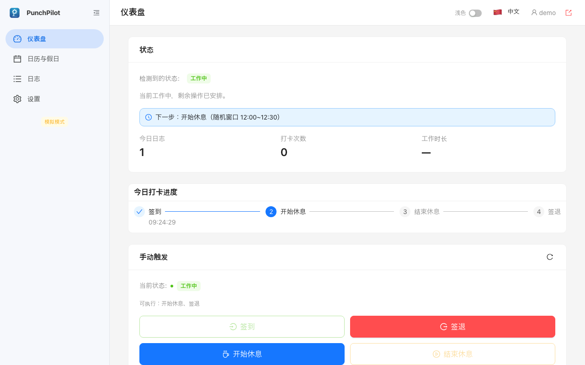
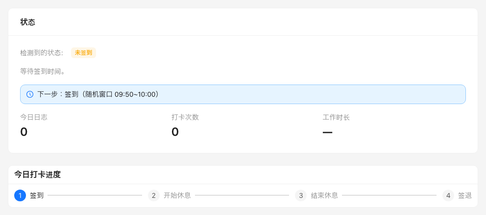
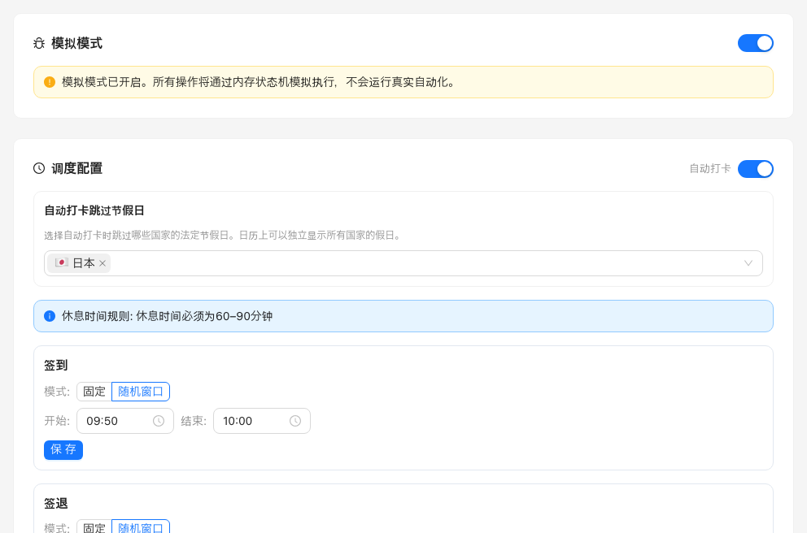

<p align="center">
  
</p>

<h1 align="center">PunchPilot</h1>

<p align="center"><b>再也不会忘记打卡。PunchPilot 在你自己的电脑或服务器上，自动完成 <a href="https://www.freee.co.jp/hr/">freee 人事劳务</a>（freee人事労務）的上下班与休息打卡。</b></p>

<p align="center"><a href="README.md">English</a> | <a href="README.ja.md">日本語</a></p>

<p align="center"><a href="#平常的一天">平常的一天</a> · <a href="#安全吗我要交出什么">安全吗？</a> · <a href="#安装">安装</a> · <a href="#常见问题">常见问题</a></p>

<p align="center">
  
  <br>
  <sub>模拟模式下的演示，数据为示例。没有任何内容发送到 freee。</sub>
</p>

> [!WARNING]
> PunchPilot 会写入你的考勤记录。公司是否允许自动打卡由公司规定，使用前请先确认。
> 这是非官方工具，与 freee 株式会社没有关联，使用风险自负。

<p align="center"><i>单用户 · 自行部署 · MIT 许可 · 需要一位熟悉 Docker 的人帮忙安装一次。</i></p>

## 平常的一天

### 它帮你规划一天

<p align="center">
  
  <br>
  <sub><b>它帮你规划一天：</b>四次打卡，时间由你设定。演示数据。</sub>
</p>

四次打卡分别是上班、开始休息、结束休息和下班。每一项可以是固定时刻，也可以在时间窗内随机取一分钟。默认值为：上班 09:50–10:00，开始休息 12:00–12:30，结束休息 13:00–13:30，下班 19:00–20:00。

### 它替你打卡，你仍然掌控一切

页首的截图就是打完上班卡后的样子。

- 每次打卡前，它会再查一次 freee。如果你已经手动打过卡，它什么也不做。
- 如果它无法确认你的状态，就会暂停，而不会凭猜测打卡：仪表盘上会显示暂停，**日志** 里会记录原因。
- 它不会覆盖 freee 上已有的打卡记录。

### 它会跳过休息日

<p align="center">
  
  <br>
  <sub><b>它会跳过休息日：</b>周末、日本法定节假日和你自己添加的自定义假日会自动跳过。演示数据。</sub>
</p>

周末、日本法定节假日、你自己添加的自定义假日，以及 freee 上显示为全天休假、缺勤或公司休息日的日子，PunchPilot 会整天不打卡。中国法定节假日可选，在 **自动打卡跳过节假日** 中勾选中国即可。

如果到了上班时间 PunchPilot 没在运行，只有晚了不超过 5 分钟，它才会立即打上班卡；否则请自己在 freee 上打卡。重试等更细的规则见 [docs/how-it-works.md](docs/how-it-works.md)。

连接 freee 账号后，同一个网页还能补漏打的日子、提交休假和出勤申请、做月度结算、审批申请。这些功能需要真实的 freee 账号，所以这里没有截图，详见 [docs/daily-use.md](docs/daily-use.md)。

## 还能做什么

- **补上忘记打卡的日子**：**补签到 → 选择所有缺勤**，然后提交。
- **申请休假、加班或假日出勤**：**休假申请**、**加班申请**、**出勤申请**。
- **撤回尚未审批的申请**：**查看申请**。
- **审批下属的申请**（如果你在 freee 中是审批人）：**查看申请 → 待审批**。
- **月末结算**：**月度结算申请**。
- **现在就打卡**：**仪表盘 → 手动触发**（Manual Trigger）。

在模拟模式下，“现在就打卡”不需要连接 freee。真实打卡和其余各项都需要安装第 5 步里的 freee 连接：freee API，部分功能也可以用 freee 网页登录。哪项用哪种，见 [docs/daily-use.md](docs/daily-use.md) 中完整的“你想要…这样做”对照表。

## 安全吗？我要交出什么

- **运行在你自己的机器上。** 服务端只连接 freee 和公开的节假日日历，没有任何遥测。
- **凭证加密保存。** 保存的 freee 凭证会在你自己的服务器上加密存储。
- **你要交出的东西：** 一个 freee 开发者应用（Client ID 和 Client Secret，通过 OAuth 授权），以及可选的 freee 网页登录信息（邮箱、密码和准确的事务所（公司）名称），用于需要它的功能。
- **拿不准就暂停，而不是猜。** 无法确认你的考勤状态、休假，或者当前操作的是哪个 freee 账号时，它不会打卡，而是暂停并写入日志。
- **没有邮件或聊天通知。** 请自己查看仪表盘和 **日志**。

**可以放心先试：** 新安装默认处于模拟模式，只模拟打卡，在你关闭它之前不会有打卡发送到 freee。但连接 freee 之后，你提交的补卡和各类申请即使在模拟模式下也会真实发送到 freee。

详情见 [SECURITY.md](SECURITY.md) 和 [docs/security-threat-model.md](docs/security-threat-model.md)。

## 安装

**你需要：**

- 一台在工作时间内保持开机、不会进入睡眠的电脑、NAS 或服务器，装有 Docker 和 Docker Compose（`linux/amd64` 或 64 位 `linux/arm64`）。
- 一个 freee 人事劳务的员工账号。
- 一个 freee 开发者应用（Client ID 和 Client Secret）。注册方法见 [docs/freee-app-setup.md](docs/freee-app-setup.md)（英文）。
- 如果你不熟悉 Docker，请同事帮你完成第 1、2 步。

### 1. 获取并启动

```bash
git clone https://github.com/sky-zhang01/punchpilot.git
cd punchpilot
cp .env.example .env
docker compose up -d
```

默认配置适用于普通电脑；部分 NAS 需要改用别的 `PUID`/`PGID`，见 [docs/configuration.md](docs/configuration.md)。

**你应该看到：** 容器已在后台运行。

### 2. 读取一次性管理员密码

```bash
docker compose exec punchpilot cat /app/keystore/initial-admin-password
```

**你应该看到：** 终端输出一串密码。

### 3. 打开页面并登录

在同一台电脑上打开 <http://localhost:8681>，以 `admin` 登录，然后设置你自己的用户名和密码。

<p align="center">
  
  <br>
  <sub>登录页右上角的语言菜单可以切换到中文或日本語。</sub>
</p>

> [!NOTE]
> NAS 或服务器上没有本地浏览器，请先按下面的“从其他设备访问”配置 HTTPS。

**你应该看到：** 进入仪表盘，侧边栏有 **模拟模式** 标签。

### 4. 先在模拟模式下试一试

在仪表盘上点击 **手动触发**，观察步骤逐项打勾。

**你应该看到：** 打卡步骤被标记为完成，没有任何内容发送到 freee。

### 5. 连接 freee

先确认 freee 应用里已经登记了回调地址 `http://localhost:8681/api/config/oauth-callback`（如果改了 `PORT`，就换成那个端口；如果使用自己的 HTTPS 地址，则登记 `https://<你的地址>/api/config/oauth-callback`）。然后在 **设置 → API 配置（OAuth2）** 中填入 Client ID 和 Client Secret，点击 **保存应用凭据**，再点击 **使用 freee 授权**；如果你有多个事务所，再选择其中一个。

然后在 **设置 → 调度配置** 中设定打卡时间和节假日选项。

<p align="center">
  
  <br>
  <sub>时间只需设置一次。在你关闭之前，模拟模式一直开着。</sub>
</p>

可选：在 **设置 → freee 网页登录** 中填入 freee 邮箱、密码和准确的事务所名称，保存时会自动验证。

**你应该看到：** **API 配置（OAuth2）** 显示已连接至 freee。

### 6. 正式启用

在设置中 **关闭模拟模式**。第一次上班时间过后，请到 freee 上确认这次打卡已经记录下来。

**你应该看到：** 侧边栏上的 **模拟模式** 标签消失，仪表盘显示下一次计划打卡的时间。

## 从其他设备访问（NAS 或服务器）

默认只能在运行 PunchPilot 的那台电脑上通过 `http://localhost:8681` 登录。如果想从别的电脑访问，请把它放到 HTTPS 反向代理后面，并在 `.env` 中设置 `PUNCHPILOT_PUBLIC_ORIGIN`。`TRUST_PROXY` 只填反向代理的地址，不能填 `true`。不要把 PunchPilot 直接暴露到公网。完整说明见 [docs/remote-access.md](docs/remote-access.md)。

## 保持运行

- **更新：** 在 `punchpilot` 文件夹中运行 `git pull`，再运行 `docker compose up -d`。更新前请先看 [CHANGELOG](CHANGELOG.md) 中的升级须知。
- **备份：** 把 `./data` 文件夹、keystore Docker 卷（通常名为 `punchpilot_keystore`）和你的 `.env` 放在一起备份。没有对应的 keystore，保存的 freee 凭证就无法解密。
- **设置项**（`TZ`、`PORT`、`PUID`/`PGID`、`PUNCHPILOT_IMAGE`）：见 [docs/configuration.md](docs/configuration.md)。

## 常见问题

<details>
<summary>能不连接 freee 先试用吗？</summary>

可以。保持模拟模式开启，打卡就只是模拟。但一旦连接了 freee，补卡、休假申请、审批和月度结算都会真实发送到 freee。见安装的第 4 步“先在模拟模式下试一试”。
</details>

<details>
<summary>忘记了 PunchPilot 的密码怎么办？</summary>

没有找回密码的功能。连续登录失败 3 次后，登录页上会显示一条恢复出厂设置的命令。它会清除 PunchPilot 的所有数据和设置，但不影响你在 freee 上的记录。运行后用 `docker compose restart punchpilot` 重新启动（如果初始密码来自 `.env`，改用 `docker compose up -d --force-recreate punchpilot`），再从安装第 2 步开始重新设置。
</details>

<details>
<summary>笔记本电脑睡眠时它还会打卡吗？</summary>

不会。它需要一台在工作时间内保持开机、不会进入睡眠的机器。
</details>

<details>
<summary>为什么今天什么也没发生？</summary>

先看仪表盘上的状态说明和 **日志**。周末、节假日和休假是有意跳过的。
</details>

<details>
<summary>应用支持哪些语言？</summary>

英语、日语和中文，在登录页上切换。
</details>

<details>
<summary>在哪里报告问题？</summary>

请到 [GitHub Issues](https://github.com/sky-zhang01/punchpilot/issues) 提交，并写明版本、你期望的结果，以及一行不含凭证的日志。
</details>

## 文档与参与开发

- [docs/](docs/) · [SECURITY.md](SECURITY.md) · [CHANGELOG.md](CHANGELOG.md) · [CONTRIBUTING.md](CONTRIBUTING.md)
- PunchPilot 起源于 [@newbdez33](https://github.com/newbdez33) 的 [freee-checkin](https://github.com/newbdez33/freee-checkin)，它提供了最初基于浏览器的 freee 考勤自动化。
- 许可证：[MIT](LICENSE)。

非官方项目，与 freee 株式会社没有关联；freee 是其权利人的商标。
