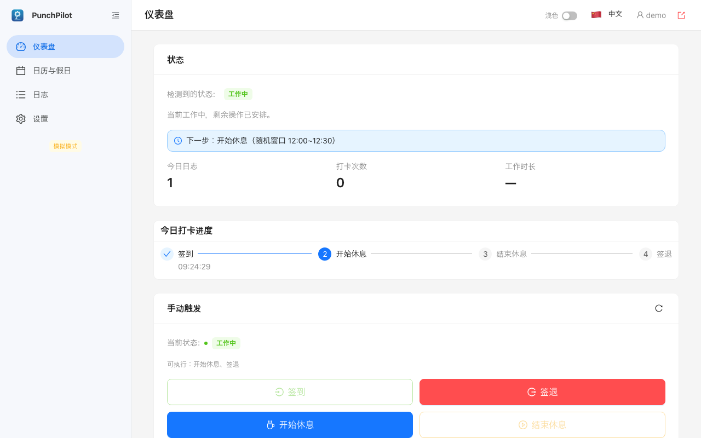
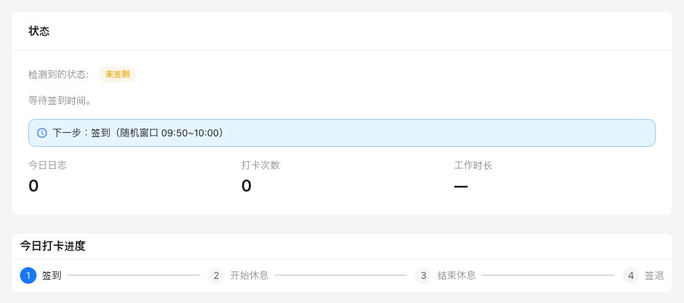
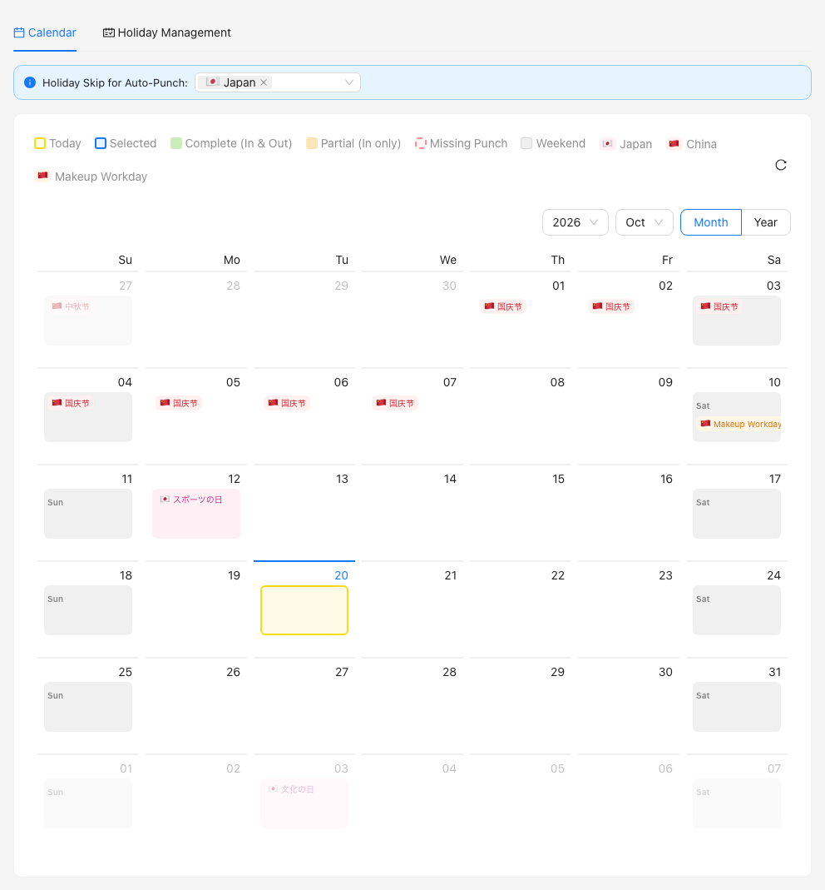
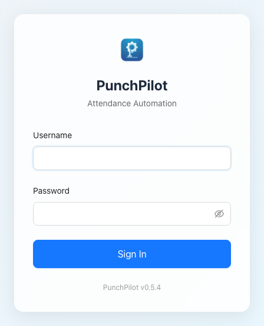
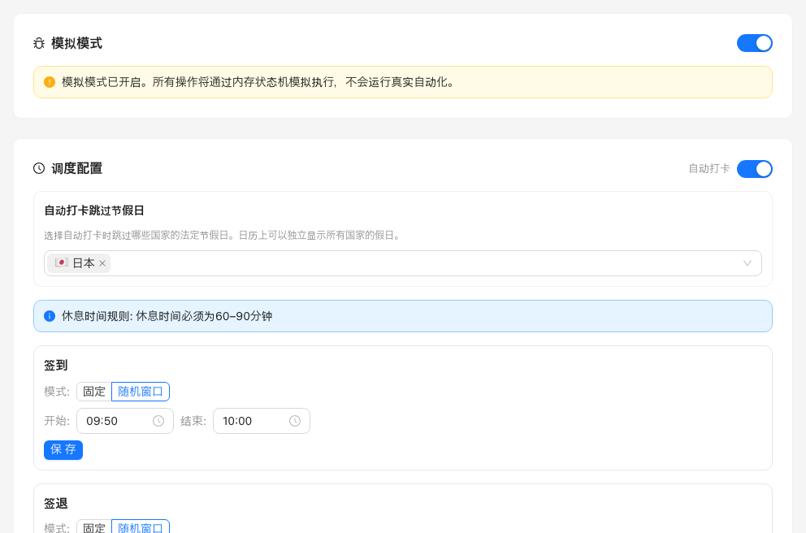

<p align="center">
  
</p>

<h1 align="center">PunchPilot</h1>

<p align="center"><b>再也不会忘记打卡。PunchPilot 在你自己的电脑或服务器上，自动完成 <a href="https://www.freee.co.jp/hr/">freee 人事劳务</a>（freee人事労務）的上下班与休息打卡。</b></p>

<p align="center"><a href="README.md">English</a> | <a href="README.ja.md">日本語</a></p>

<p align="center"><a href="#平常的一天">平常的一天</a> · <a href="#安全吗我要交出什么">安全吗？</a> · <a href="#安装">安装</a> · <a href="#常见问题">常见问题</a></p>

<p align="center">
  
  <br>
  <sub>模拟模式下的演示，数据为示例。没有任何内容发送到 freee。</sub>
</p>

> [!WARNING]
> PunchPilot 会写入你的考勤记录。公司是否允许自动打卡由公司规定，使用前请先确认。
> 这是非官方工具，与 freee 株式会社没有关联，使用风险自负。

<p align="center"><i>单用户 · 自行部署 · MIT 许可 · 需要一位熟悉 Docker 的人帮忙安装一次。</i></p>

## 平常的一天

### 它帮你规划一天

<p align="center">
  
  <br>
  <sub><b>它帮你规划一天：</b>四次打卡，时间由你设定。演示数据。</sub>
</p>

四次打卡分别是上班、开始休息、结束休息和下班。每一项可以是固定时刻，也可以在时间窗内随机取一分钟。默认值为：上班 09:50–10:00，开始休息 12:00–12:30，结束休息 13:00–13:30，下班 19:00–20:00。自动打卡默认还会保证至少 8 小时的净工作时长（下班减上班再减休息），并把休息安排在 60 至 75 分钟之间。这两项都可以在 **设置 → 调度配置** 中修改。

### 它替你打卡，你仍然掌控一切

页首的截图就是打完上班卡后的样子。

- 每次打卡前，它会再查一次 freee。如果你已经手动打过卡，它什么也不做。
- 如果它无法确认你的状态，就会暂停，而不会凭猜测打卡：仪表盘上会显示暂停，**日志** 里会记录原因。
- 它不会覆盖 freee 上已有的打卡记录。

### 它会跳过休息日

<p align="center">
  
  <br>
  <sub><b>它会跳过休息日：</b>周末、日本法定节假日和你自己添加的自定义假日会自动跳过。演示数据。</sub>
</p>

周末、日本法定节假日、你自己添加的自定义假日，以及 freee 上显示为全天休假、缺勤或公司休息日的日子，PunchPilot 会整天不打卡。中国法定节假日可选，在 **自动打卡跳过节假日** 中勾选中国即可。

如果到了上班时间 PunchPilot 没在运行，只有晚了不超过 5 分钟，它才会立即打上班卡；否则请自己在 freee 上打卡。如果 PunchPilot 在运行，但 freee 暂时不可用或被限流，它会重试约一小时。每次重试前都会先读取 freee 的打卡记录，所以不会重复打卡。重试期间，仪表盘可能把这一步显示为失败。如果最终仍然失败，**日志** 页会记录原因，请自己在 freee 上打卡。

连接 freee 账号后，同一个网页还能补漏打的日子、提交休假、加班和假日出勤申请、撤回尚未审批的申请、审批下属的申请，以及做月度结算。这些功能需要真实的 freee 账号，所以这里没有截图。

## 还能做什么

- **补上忘记打卡的日子**：**补签到 → 选择所有缺勤**，然后提交。
- **申请休假、加班或假日出勤**：**休假申请**、**加班申请**、**出勤申请**。
- **撤回尚未审批的申请**：**查看申请**。
- **审批下属的申请**（如果你在 freee 中是审批人）：**查看申请 → 待审批**。
- **月末结算**：**月度结算申请**。
- **现在就打卡**：**仪表盘 → 手动触发**（Manual Trigger）。

在模拟模式下，“现在就打卡”不需要连接 freee。真实打卡和其余各项都需要安装第 5 步里的 freee 连接。大部分功能只用 API 连接，少数还需要 freee 网页登录：

| 功能 | 需要什么 |
| --- | --- |
| 定时打卡和手动打卡 | API 连接 |
| 补签到、休假申请和加班申请、撤回申请 | API 连接 |
| 假日出勤申请 | 一律需要 freee 网页登录 |
| 待审批申请与审批 | API 连接；公司使用 freee 审批流程时才会显示 |
| 月度结算 | 公司使用审批流程，或已保存 freee 网页登录时才会显示 |

不填网页登录时，API 能做的事情仍然都能用。公司的审批流程无法通过 API 处理时，PunchPilot 也会用到网页登录。

## 安全吗？我要交出什么

- **运行在你自己的机器上。** 服务端只连接 freee 和公开的节假日日历，没有任何遥测。
- **凭证加密保存。** 保存的 freee 凭证会在你自己的服务器上加密存储。
- **你要交出的东西：** 一个 freee 开发者应用（Client ID 和 Client Secret，通过 OAuth 授权），以及可选的 freee 网页登录信息（邮箱、密码和准确的事务所（公司）名称），用于需要它的功能。
- **拿不准就暂停，而不是猜。** 无法确认你的考勤状态、休假，或者当前操作的是哪个 freee 账号时，它不会打卡，而是暂停并写入日志。
- **没有邮件或聊天通知。** 请自己查看仪表盘和 **日志**。

**可以放心先试：** 新安装默认处于模拟模式，只模拟打卡，在你关闭它之前不会有打卡发送到 freee。但连接 freee 之后，你提交的补卡和各类申请即使在模拟模式下也会真实发送到 freee。

如需报告安全漏洞，请使用 GitHub 的[私密漏洞报告](https://github.com/sky-zhang01/punchpilot/security/advisories/new)，不要为此公开提交 issue。

## 安装

**你需要：**

- 一台在工作时间内保持开机、不会进入睡眠的电脑、NAS 或服务器，装有 Docker 和 Docker Compose（`linux/amd64` 或 64 位 `linux/arm64`）。
- 一个 freee 人事劳务的员工账号。
- 一个 freee 开发者应用（Client ID 和 Client Secret）。见下一节。
- 如果你不熟悉 Docker，请同事帮你完成第 1、2 步。

### 注册 freee 开发者应用

请按 freee 开发者官网 <https://developer.freee.co.jp/> 的官方指南创建应用。控制台菜单会变化，这里不再重复。PunchPilot 要求你在应用中登记的只有回调地址：

| 你访问 PunchPilot 的方式 | 要登记的回调地址 |
| --- | --- |
| 在同一台电脑上 | `http://localhost:8681/api/config/oauth-callback` |
| 同一台电脑，改过 `PORT` | `http://localhost:<你的端口>/api/config/oauth-callback` |
| 你自己的 HTTPS 地址（见[从其他设备访问](#从其他设备访问nas-或服务器)） | `https://<你的地址>/api/config/oauth-callback` |

以后如果换了地址或端口，也要在 freee 应用里登记对应的回调地址。

### 1. 获取并启动

```bash
git clone https://github.com/sky-zhang01/punchpilot.git
cd punchpilot
cp .env.example .env
docker compose up -d
```

默认配置适用于普通电脑；部分 NAS 需要改用别的 `PUID`/`PGID`，它们决定 `./data` 中文件的所有者用户和组。请在 `.env` 中修改；[`.env.example`](.env.example) 里的注释说明了每一项设置。

**你应该看到：** 容器已在后台运行。

### 2. 读取一次性管理员密码

```bash
docker compose exec punchpilot cat /app/keystore/initial-admin-password
```

**你应该看到：** 终端输出一串密码。

### 3. 打开页面并登录

在同一台电脑上打开 <http://localhost:8681>，以 `admin` 登录，然后设置你自己的用户名和密码。

<p align="center">
  
  <br>
  <sub>登录页右上角的语言菜单可以切换到中文或日本語。</sub>
</p>

> [!NOTE]
> NAS 或服务器上没有本地浏览器，请先按下面的“从其他设备访问”配置 HTTPS。

**你应该看到：** 进入仪表盘，侧边栏有 **模拟模式** 标签。

### 4. 先在模拟模式下试一试

在仪表盘上点击 **手动触发**，观察步骤逐项打勾。

**你应该看到：** 打卡步骤被标记为完成，没有任何内容发送到 freee。

### 5. 连接 freee

先确认 freee 应用里已经登记了上表中对应的回调地址。然后在 **设置 → API 配置（OAuth2）** 中填入 Client ID 和 Client Secret，点击 **保存应用凭据**，再点击 **使用 freee 授权** 并在 freee 中同意访问。如果你的 freee 账号关联了多个事务所，PunchPilot 会提示“检测到多个事务所”，请用 **选择事务所** 选出用于考勤的那一个，之后可用 **切换事务所** 更改。Client Secret 和令牌都会加密后再保存。

然后在 **设置 → 调度配置** 中设定打卡时间和节假日选项。

<p align="center">
  
  <br>
  <sub>时间只需设置一次。在你关闭之前，模拟模式一直开着。</sub>
</p>

可选：在 **设置 → freee 网页登录** 中填入 freee 邮箱、密码和准确的事务所名称，保存时会自动验证。“还能做什么”里的表格说明了哪些功能需要它。

**你应该看到：** **API 配置（OAuth2）** 显示已连接至 freee。

### 6. 正式启用

在设置中 **关闭模拟模式**。第一次上班时间过后，请到 freee 上确认这次打卡已经记录下来。

**你应该看到：** 侧边栏上的 **模拟模式** 标签消失，仪表盘显示下一次计划打卡的时间。

## 从其他设备访问（NAS 或服务器）

默认只能在 `localhost` 页面登录。从其他设备打开时页面也许能以普通 `http://` 显示，但登录会被有意拒绝。想在手机或别的电脑上使用 PunchPilot：

1. 把 PunchPilot 放到 HTTPS 反向代理后面。
2. 在 `.env` 中设置两项：
   - `PUNCHPILOT_PUBLIC_ORIGIN`：你的 HTTPS 地址，例如 `https://punchpilot.example.com`。
   - `TRUST_PROXY`：反向代理连接 PunchPilot 时使用的地址。
3. 在 freee 应用中登记回调地址 `https://<你的地址>/api/config/oauth-callback`。
4. 运行 `docker compose up -d`。

之后请在 HTTPS 地址登录，`localhost` 登录将不再可用。Secure Cookie 和 HSTS 跟随 `PUNCHPILOT_PUBLIC_ORIGIN`，所以浏览器里也要使用同一个地址。

`TRUST_PROXY` 是地址列表，不是开关。PunchPilot 只信任来自所列地址的转发头，所以列表越窄越好。

| 取值 | 是否接受 |
| --- | --- |
| 代理的确切 IP 地址或 CIDR 范围 | 接受，推荐 |
| `loopback`、`linklocal`、`uniquelocal`（命名范围，适合容器网络） | 接受 |
| `true` 之类的开关值 | 不接受，PunchPilot 会拒绝启动 |

不要把 PunchPilot 直接暴露到公网。只通过 HTTPS 反向代理访问它，并保留代理本身的访问控制。

## 保持运行

- **更新：** 在 `punchpilot` 文件夹中运行 `git pull`，再运行 `docker compose up -d`。Compose 会下载新镜像；如果你在 `.env` 里设置了 `PUNCHPILOT_IMAGE`，也要同步修改其中的版本。正在执行的打卡或批量任务会先完成，可能需要几分钟。更新前请先看 [CHANGELOG](CHANGELOG.md) 中的升级须知。
- **备份：** 把 `./data` 文件夹、`punchpilot_keystore` 卷和你的 `.env` 放在一起备份。保存的 freee 凭证用 keystore 里的密钥加密，没有对应的 keystore 就无法解密。`./data` 中的其余内容（日志、日程、事务所名称）没有加密，备份请妥善保管。
- **`.env` 中的设置：** `TZ`（日程使用的时区，默认 `Asia/Tokyo`）、`PORT`（默认 `8681`；改动后要登记对应的回调地址）、`PUID`/`PGID`（数据文件的所有者，默认 `1000`）和 `PUNCHPILOT_IMAGE`（把发布的镜像固定到某个版本）。其余设置见 [`.env.example`](.env.example) 中的注释。
- **初始管理员密码：** 想用自己的密码而不是自动生成的，请在 `PUNCHPILOT_INITIAL_ADMIN_PASSWORD` 和 `PUNCHPILOT_INITIAL_ADMIN_PASSWORD_FILE` 中只设置一个（推荐后者，因为容器环境变量可以被查看）。密码至少 16 字节，且不要放进版本管理。

## 常见问题

<details>
<summary>能不连接 freee 先试用吗？</summary>

可以。保持模拟模式开启，打卡就只是模拟。但一旦连接了 freee，补卡、休假申请、审批和月度结算都会真实发送到 freee。见安装的第 4 步“先在模拟模式下试一试”。
</details>

<details>
<summary>忘记了 PunchPilot 的密码怎么办？</summary>

没有找回密码的功能。连续登录失败 3 次后，登录页上会显示一条恢复出厂设置的命令。它会清除 PunchPilot 的所有数据和设置，但不影响你在 freee 上的记录。运行后用 `docker compose restart punchpilot` 重新启动（如果初始密码来自 `.env`，改用 `docker compose up -d --force-recreate punchpilot`），再从安装第 2 步开始重新设置。
</details>

<details>
<summary>我要早退、加班，或者请了 freee 上还没显示的假。</summary>

如果你自己下班打了卡，PunchPilot 会看到这次打卡并跳过自动下班打卡。要加班，或要休假、出差而 freee 上还没显示时，请在 **设置 → 调度配置** 中关闭 **自动打卡**，离开时在 **手动触发** 里点 **签退**，并在下一个工作日之前重新打开 **自动打卡**。PunchPilot 只会跳过 freee 上已经显示的休假。
</details>

<details>
<summary>仪表盘显示“重新授权”横幅。</summary>

freee 要求你重新登录。在你于 **设置 → API 配置（OAuth2）** 中点击 **使用 freee 授权** 之前，自动打卡会一直暂停。
</details>

<details>
<summary>笔记本电脑睡眠时它还会打卡吗？</summary>

不会。它需要一台在工作时间内保持开机、不会进入睡眠的机器。
</details>

<details>
<summary>为什么今天什么也没发生？</summary>

先看仪表盘上的状态说明和 **日志**。周末、节假日和休假是有意跳过的。
</details>

<details>
<summary>应用支持哪些语言？</summary>

英语、日语和中文，在登录页上切换。
</details>

<details>
<summary>在哪里报告问题？</summary>

请到 [GitHub Issues](https://github.com/sky-zhang01/punchpilot/issues) 提交，并写明版本、你期望的结果，以及一行不含凭证的日志。
</details>

## 更新记录与许可证

- [CHANGELOG.md](CHANGELOG.md)
- [MIT 许可证](LICENSE)

PunchPilot 起源于 [@newbdez33](https://github.com/newbdez33) 的 [freee-checkin](https://github.com/newbdez33/freee-checkin)，它提供了最初基于浏览器的 freee 考勤自动化。

非官方项目，与 freee 株式会社没有关联；freee 是其权利人的商标。
